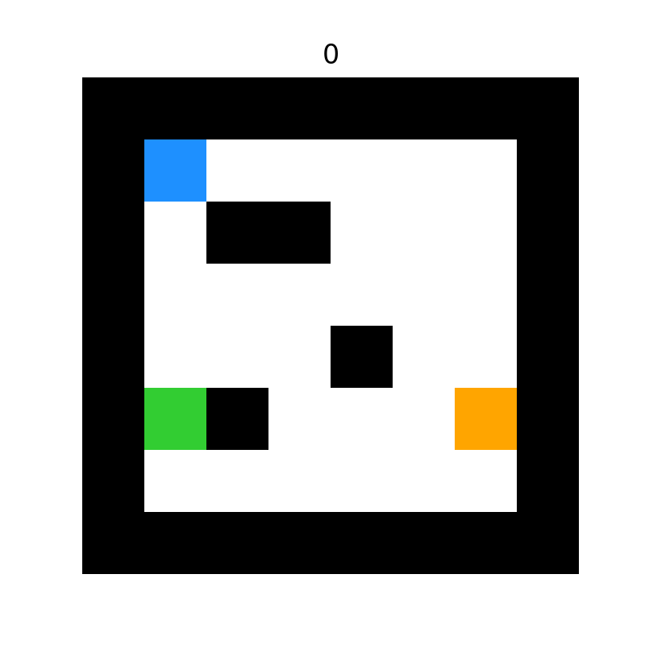

# Grid-World Pick-And-Place Agents

A robot has to reach an object, pick it up, and then find its way to the goal cell to finish. This project compares three agents on this task: Random Agent, Simple Reflex Agent and Goal-based Agent (using BFS).

## Demo

The robot (blue) walks to the object (orange), picks it up (the robot turns red), and places it on the goal cell (green). Black cells are walls and the borders of the map.

## Project structure 

| File | Description |
|---|---|
| `environment.py` | The `Robot` and `Environment` classes: the grid, walls, object, goal, and the rules for each action |
| `agents.py` | The three agents: `RandomAgent`, `SimpleReflexAgent`, and `GoalBasedAgent` |
| `search.py` | Search functions: `neighbors`, `bfs_distance`, and `find_path` |
| `main.py` | Runs the experiment, evaluates each agent, and draws the comparison chart |
| `animate.py` | Records the frames of one episode, plays the animation, and saves it as `demo.gif` |

## How to run

You need Python and the `matplotlib` library:

    `pip install matplotlib`

Then run the following command in the terminal, from the project folder: 

    `python main.py`

To run the animation:

    `python animate.py`

Run both commands from the project folder.

## Results

The Random agent needs the most steps, and the Goal-based agent needs the fewest. The Random agent takes about 660 times more steps than the Goal-based agent. This shows that the Goal-based agent benefits from knowing the whole map and planning its path in advance. Each agent was run 100 times and `max_steps = 20000`.

## Limitations

- The walls are fixed; only the object and the goal change between runs.
- The average number of steps is only counted over successful runs.
- The results of the Random agent fluctuate between runs.

## Future work

I plan to try Q-learning, where the agent learns by trial and error instead of using a map.
