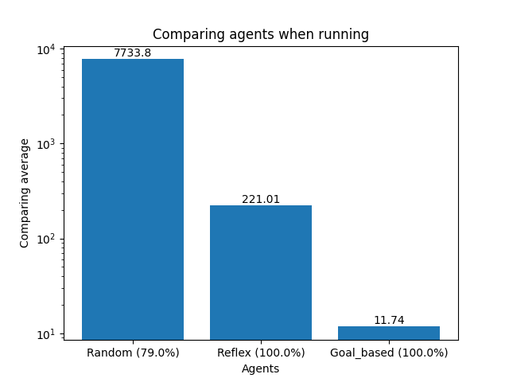

# Grid-World Pick-And-Place Agents

A robot has to reach an object, pick it up, and then find its way to the goal cell to finish. This project compares three agents on this task: Random Agent, Simple Reflex Agent and Goal-based Agent (using BFS).

## How to run

You need Python and the `matplotlib` library by `pip install matplotlib`.

Then run **python gridworld-pickandplace.py** in the terminal to run.

## Results

Random agent needs the most steps, and the Goal-based agent needs the fewest. The Random agent takes about 550 times more steps than the Goal-based agent. This shows that the Goal-based agent benefits from knowing the whole map and planning its path in advance. Each agent was run 100 times and 'max_steps = 20000'.

## Limitations

- The walls are fixed; only the object and the goal change between runs.
- The average number of steps is only counted over successful runs.
- The results of the Random agent fluctuate between runs.

## Future work

I plan to add an animation and, if possible, try Q-learning.
